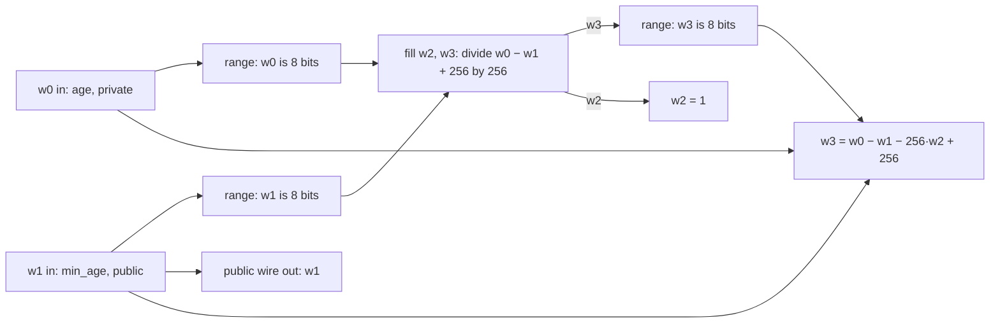

# Prove it without revealing it

Easy case for the Nazarbayev University ZK workshop. You compile a three-line Noir circuit, solve a witness, look at what is secret and what is public, then generate and verify a proof.

The circuit claims: **this age is at least the threshold**. The age stays on your machine. The verifier only receives the threshold and a proof.

```noir
fn main(age: u8, min_age: pub u8) {
    assert(age >= min_age);
}
```

| Input | In `Prover.toml` | Who can see it |
| --- | --- | --- |
| `age` | `"25"` | You. It is a private witness. |
| `min_age` | `"18"` | Everyone. The `pub` marker makes it part of the statement. |

`Prover.toml` stores both numbers as strings. They are still the integers 25 and 18.

## Install

You need two command-line tools, pinned to the versions this circuit was proven with:

- **Nargo 1.0.0** — the Noir compiler. It checks the circuit and writes the witness.
- **Barretenberg `bb` 6.0.0** — the prover and verifier.

`noirup` and `bbup` download prebuilt binaries. This workshop does not build either tool, so a Rust toolchain is only involved if you later compile Nargo from source.

macOS and Linux:

```bash
curl -L https://raw.githubusercontent.com/noir-lang/noirup/main/install | bash
noirup -v 1.0.0

curl -L https://raw.githubusercontent.com/AztecProtocol/aztec-packages/refs/heads/next/barretenberg/bbup/install | bash
bbup -v 6.0.0
```

Open a new terminal so `PATH` picks up `~/.nargo/bin` and `~/.bb`. Then check:

```bash
nargo --version
bb --version
```

You want `nargo version = 1.0.0` and `6.0.0`.

Windows: use WSL, then the same commands.

## Run the easy case

From this repository:

```bash
cd age_proof
```

### Circuit

Print the source:

```bash
cat src/main.nr
```

That is the three lines above. Compile it and print the circuit the prover runs:

```bash
nargo execute --print-acir
```

A good run prints the ACIR, then:

```text
[age_proof] Circuit witness successfully solved
[age_proof] Witness saved to target/age_proof.gz
```

The ACIR for `main` starts like this:

```text
private parameters: [w0]
public parameters: [w1]
return values: []
BLACKBOX::RANGE input: w0, bits: 8
BLACKBOX::RANGE input: w1, bits: 8
BRILLIG CALL func: 0, predicate: 1, inputs: [w0 - w1 + 256, 256], outputs: [w2, w3]
BLACKBOX::RANGE input: w3, bits: 8
ASSERT w3 = w0 - w1 - 256*w2 + 256
ASSERT w2 = 1
```

`w0` is `age`. `w1` is `min_age`. Both are range-checked to 8 bits. The last assert is `age >= min_age`: the quotient of that division, `w2`, has to be 1.

The same constraints as wires:



`w0` and `w1` enter. The division fills `w2` and `w3`. For 25 and 18 that is `(25 − 18 + 256) / 256`, quotient 1 and remainder 7. The circuit returns no value. The verifier is shown `w1`.

`nargo info` prints the size of this circuit: 6 ACIR opcodes.

The same command writes `age_proof/target/` (gitignored):

| File | What it is |
| --- | --- |
| `age_proof.json` | Compiled circuit (ACIR bytecode). |
| `age_proof.gz` | Solved witness, in a binary form `bb` reads. |
| `proof.json` | Created when you prove. |
| `public_inputs.json` | Created when you prove. The statement the verifier checks. |
| `vk.json` | Verification key. Created when you prove. |

### Witness

Print the inputs:

```bash
cat Prover.toml
```

```text
age = "25"
min_age = "18"
```

`Prover.toml` is the witness you can read. `age` is private. `min_age` is public because the circuit marks it `pub`. `nargo execute` already checked `age >= min_age` and wrote the solved witness to `target/age_proof.gz`.

That file is binary. Dump it:

```bash
gzip -dc target/age_proof.gz | xxd
```

A good dump is ten lines. Two of the bytes are the inputs: `19` is 25, and `12` is 18. The other two values are wires from the comparison: `01` is the quotient `w2`, and `07` is the difference `w3` (25 − 18).

### Proof

```bash
bb prove -b ./target/age_proof.json -w ./target/age_proof.gz -o ./target --write_vk --output_format json
```

`bb prove` prints `WARNING: computing verification key while proving`. That is expected with `--write_vk`. The command still writes the three JSON files.

Print the statement the verifier checks:

```bash
cat target/public_inputs.json
```

With the checked-in inputs it looks like this:

```json
{"public_inputs":["0x0000000000000000000000000000000000000000000000000000000000000012"],"bb_version":"6.0.0","scheme":"ultra_honk"}
```

The last two hex digits are `12`, which is 18 in decimal. That is `min_age`. The only public value in this file is the threshold.

Print the proof. The file is one JSON object with hundreds of values, so this command prints its shape:

```bash
python3 -c 'import json; p=json.load(open("target/proof.json")); print(p["scheme"], p["bb_version"]); print(len(p["proof"]), "values")'
```

```text
ultra_honk 6.0.0
458 values
```

`target/proof.json` holds those 458 values, the scheme, and the verification-key hash. The full file is there if you want to scroll it. The age is not one of the values.

Verify with the key and those public inputs:

```bash
bb verify -p ./target/proof.json -k ./target/vk.json -i ./target/public_inputs.json
```

A good run ends with `Proof verified successfully`.

## Experiments

Edit `Prover.toml`, then run `nargo execute` again. Prove again when you want a new `public_inputs.json`.

1. **Too young.** Set `age = "17"` and leave `min_age = "18"`. Execution stops on `assert(age >= min_age)` with `Cannot satisfy constraint`. There is no witness, so there is nothing to prove.
2. **Same statement, different secret.** Set `age = "30"`, then set `age = "18"`. Both succeed. Prove both. `public_inputs.json` still ends in `12` (decimal 18). Changing the private age leaves the statement the same.
3. **Different statement.** Set `min_age = "21"` and `age = "25"`. After you prove, `public_inputs.json` ends in `15`, which is 21 in hex. Changing a `pub` input changes what the verifier checks.
4. **Boundary.** `age = "18"` and `min_age = "18"` passes, because the circuit uses `>=`.

Return `Prover.toml` to `age = "25"` and `min_age = "18"` before you leave.

## Layout

```text
age_proof/
├── Nargo.toml      # package name
├── Prover.toml     # age (private) and min_age (public)
└── src/main.nr     # the circuit
```

## Phone demo

The same roles show up in a real age check: your phone holds the witness, and a website checks a public statement such as "18 or older". The hosted walkthrough is [demo.zkpassport.id](https://demo.zkpassport.id). This repository is the small circuit you compile yourself.
